<picture>
<source media="(prefers-color-scheme: dark)" srcset="banner-dark.svg">

</picture>

<picture><source media="(prefers-color-scheme: dark)" srcset="https://img.shields.io/badge/TypeScript-21262d?style=for-the-badge&logo=typescript&logoColor=3fb68b"></picture>
<picture><source media="(prefers-color-scheme: dark)" srcset="https://img.shields.io/badge/React-21262d?style=for-the-badge&logo=react&logoColor=3fb68b"></picture>
<picture><source media="(prefers-color-scheme: dark)" srcset="https://img.shields.io/badge/Node.js-21262d?style=for-the-badge&logo=nodedotjs&logoColor=3fb68b"></picture>
<picture><source media="(prefers-color-scheme: dark)" srcset="https://img.shields.io/badge/Postgres-21262d?style=for-the-badge&logo=postgresql&logoColor=3fb68b"></picture>
<picture><source media="(prefers-color-scheme: dark)" srcset="https://img.shields.io/badge/Python-21262d?style=for-the-badge&logo=python&logoColor=3fb68b"></picture>
<picture><source media="(prefers-color-scheme: dark)" srcset="https://img.shields.io/badge/Cloudflare-21262d?style=for-the-badge&logo=cloudflare&logoColor=3fb68b"></picture>

I'm a software engineer in Connecticut and I run [Shadow Vivo LLC](https://shadowvivo.com). People bring me a web app that already has real users and real money moving through it, and I keep it running while I make the risky parts safe.

Open to full-time roles and contract work · [josh@shadowvivo.com](mailto:josh@shadowvivo.com) · [shadowvivo.com](https://shadowvivo.com)

## What I do

**Takeovers** 
Inherit a production app with real users and payments. Keep it up, then own it end to end: frontend, backend, data and deploys.

**Hardening** 
Fix what hurts most when it breaks: payment ledgers, credential rotation, access control and personal data.

**Agent tooling** 
Build agents that keep a human in the loop for anything that changes something.

## How I work

<table>
<tr><td><code>money</code></td><td>Append-only. A correction is a reversal row, never an edit.</td></tr>
<tr><td><code>shipping</code></td><td>Nothing is "live" until the running site proves it.</td></tr>
<tr><td><code>bugs</code></td><td>Reproduce it, find the cause, change one thing.</td></tr>
<tr><td><code>agents</code></td><td>Reads and drafts are free. Writes wait for a human yes.</td></tr>
<tr><td><code>secrets</code></td><td>Rotate all of them, then confirm every old one is dead.</td></tr>
</table>

## Featured

**[exactly-once-webhooks](https://github.com/joshuavivo/exactly-once-webhooks)** — process a payment webhook once, even when the provider delivers it twice or two copies race. On npm, published with provenance: `npm install exactly-once-webhooks`. Postgres, Redis and in-memory stores all held to one shared contract test, no runtime dependencies, the double-credit race proven by a test. Its [DESIGN.md](https://github.com/joshuavivo/exactly-once-webhooks/blob/main/DESIGN.md#alternatives-and-why-this-design-doesnt-use-them) says why it doesn't use check-then-insert, advisory locks or SERIALIZABLE retries.

**Start here:** its [payment-path example](https://github.com/joshuavivo/exactly-once-webhooks/tree/main/examples/payment-path) is the whole path in one place: signature check → exactly once → an append-only ledger row in the same Postgres transaction → dead letter, with a test for each step. `node examples/payment-path/demo.ts` runs it.

## More samples

<table>
<tr><td><a href="https://github.com/joshuavivo/ai-built-app-teardown">ai-built-app-teardown</a></td><td>A fictional AI-built app, audited: nine vulnerabilities, each with an exploit test that proves it and a fix that closes it.</td></tr>
<tr><td><a href="https://github.com/joshuavivo/agent-permission-gate">agent-permission-gate</a></td><td>A gate between an AI agent and its tools: reads run, writes wait for a person, and an agent that obeys injected text still can't approve one (tested; see Limits).</td></tr>
<tr><td><a href="https://github.com/joshuavivo/append-only-ledger">append-only-ledger</a></td><td>A payments ledger where rows are never edited: database triggers block updates and deletes, corrections are reversal rows, and a hash chain catches tampering.</td></tr>
<tr><td><a href="https://github.com/joshuavivo/webhook-crm-alert">webhook-crm-alert</a></td><td>Payment webhook → CRM → chat alert, built for the failure cases: bad signatures, duplicates, retries and a dead-letter record.</td></tr>
</table>

Each is small, tested, CI-green, and documents its own limits (in a `DESIGN.md` or a Limits section).

## Work in other projects

- **[porsager/postgres #1345](https://github.com/porsager/postgres/pull/1345)** (merged): a `sql.begin` or `sql.reserve` still waiting for a connection can now be cancelled.

## About this profile

My client work is private and stays that way, so the public history here starts in November 2026. The repos pinned below are small samples of how I build — architected and directed by me, built fast with AI tooling (Claude). The design calls and the judgment are mine.

Proof you can check: the live site I run, [shadowvivo.com](https://shadowvivo.com), and a working demo of the support portal I built, [shadowvivo.com/support-demo](https://shadowvivo.com/support-demo/). Client reviews, all 5.0: [my Upwork profile](https://www.upwork.com/freelancers/joshuav68).

<a href="https://www.linkedin.com/in/joshuavivo/"><picture><source media="(prefers-color-scheme: dark)" srcset="https://img.shields.io/badge/LinkedIn-21262d?style=for-the-badge"></picture></a>
<a href="https://x.com/JvivoEng"><picture><source media="(prefers-color-scheme: dark)" srcset="https://img.shields.io/badge/X-21262d?style=for-the-badge"></picture></a>
<a href="mailto:josh@shadowvivo.com"><picture><source media="(prefers-color-scheme: dark)" srcset="https://img.shields.io/badge/josh@shadowvivo.com-21262d?style=for-the-badge"></picture></a>

